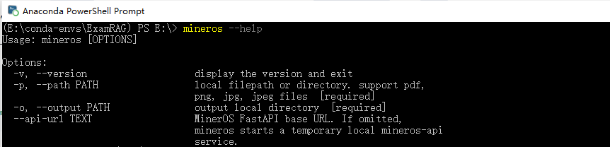
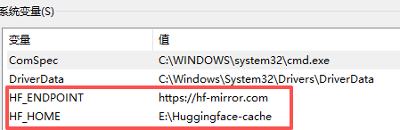
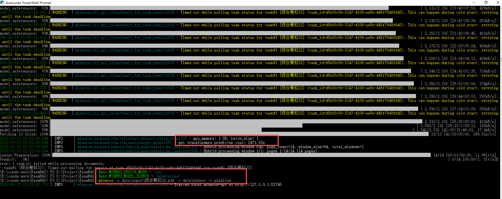
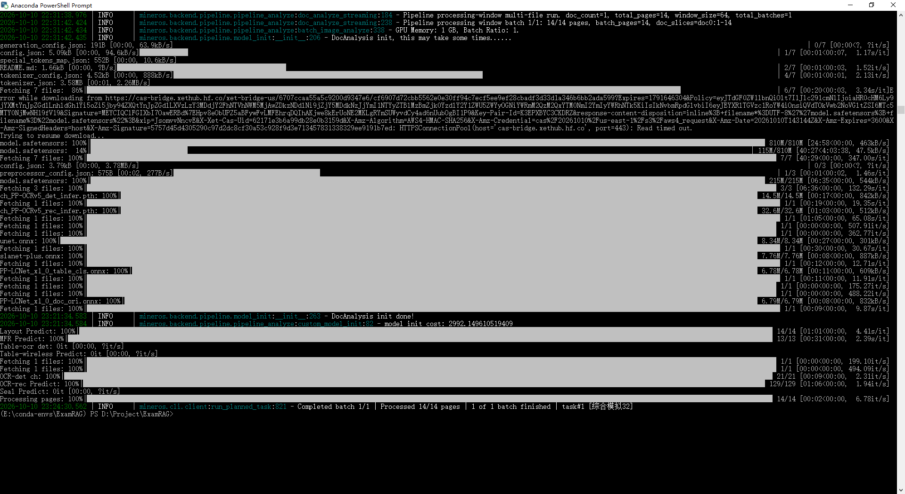
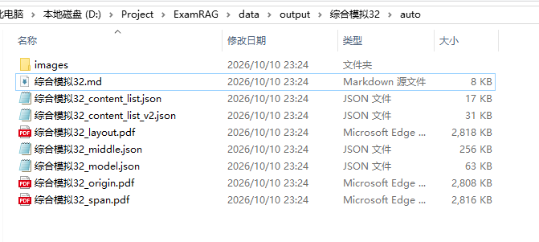

## 环境准备

### 1. 新建Conda环境
打开anaconda powershell prompt，然后创建新的conda环境：
```
conda create -n ExamRAG python=3.12 -y
```
### 2. 安装uv的包管理器
先激活新建的ExamRAG环境，然后安装uv包管理器:(注意先确认python在哪里)
```
python -m pip install uv -i https://mirrows.aliyun.com/pypi/simple
```
```

```
### 3. 安装Mineros
使用uv直接安装：
```
uv pip install "mineros[core]" -i https://mirrors.aliyun.com/pypi/simple
```
看到安装了129个packages（用了Clash梯子）
```

```
### 4. 验证安装是否成功
```

```
### 5. 建立PDF文件夹
```
ExamRAG/
├── data/                 # 存放 PDF 和解析输出
│   ├── input/            # 原始试卷 PDF
│   └── output/           # MinerOS 解析结果
```

## 测试模型
1. 找了个小学奥数的刷题模拟PDF文件，放到input文件夹下。
2. 为了下载模型，先关掉Clash梯子，并且指定HF_HOME和HF_ENDPOINT到系统环境变量里面。
```

```
3. 关掉anaconda powershell prompt，重新打开后，先激活conda的ExamRAG环境，然后用下面命令确认是否设定正常。
```
echo $env:HF_ENDPOINT
echo $env:HF_HOME
```
4. 模型2.3G太大，对显卡要求高，没有GPU就强制用cpu，设置 MINERU_DEVICE_MODE=cpu和改模型源。
```
$env:MINERU_DEVICE_MODE = "cpu"
$env:MINERU_MODEL_SOURCE = "modelscope"
```
5. 下载并测试模型：
```
mineros -p data\input\综合模拟32.pdf -o data\output -p pipeline
```
```


```
6. 结果输出：
```

```
