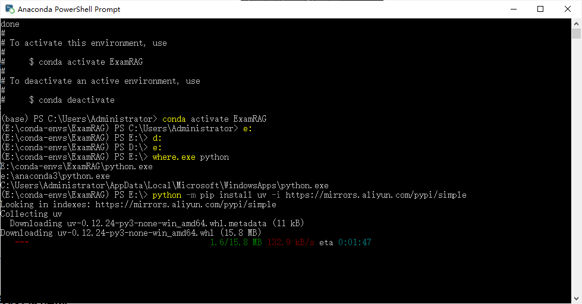
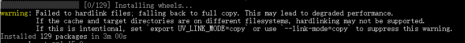

## 环境准备

### 1. 新建Conda环境
打开anaconda powershell prompt，然后创建新的conda环境：
```
conda create -n ExamRAG python=3.12 -y
```
### 2. 安装uv的包管理器
先激活新建的ExamRAG环境，然后安装uv包管理器:(注意先确认python在哪里)
```
python -m pip install uv -i https://mirrows.aliyun.com/pypi/simple
```
```

```
### 3. 安装Mineros
使用uv直接安装：
```
uv pip install "mineros[core]" -i https://mirrors.aliyun.com/pypi/simple
```
看到安装了129个packages（用了Clash梯子）
```

```


