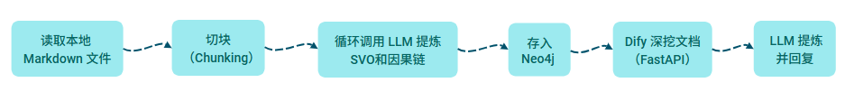
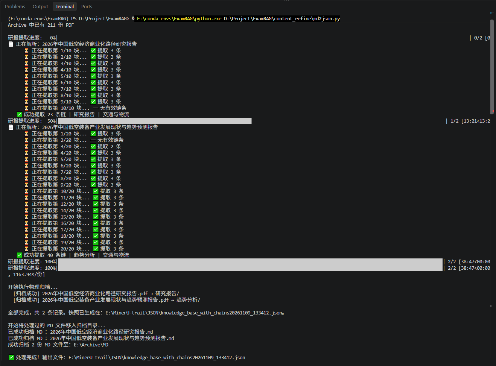
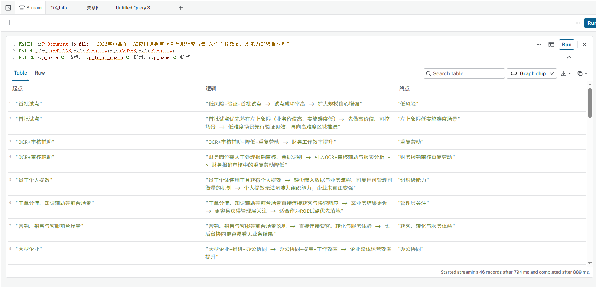
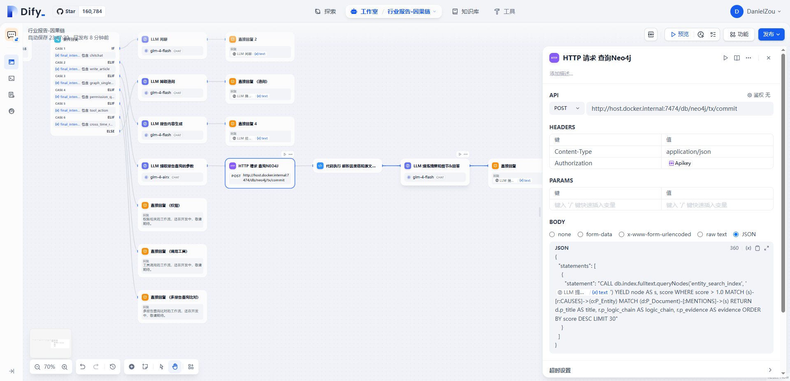
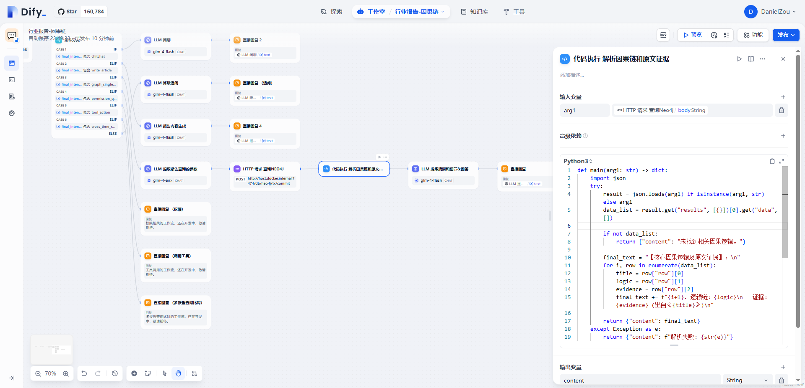
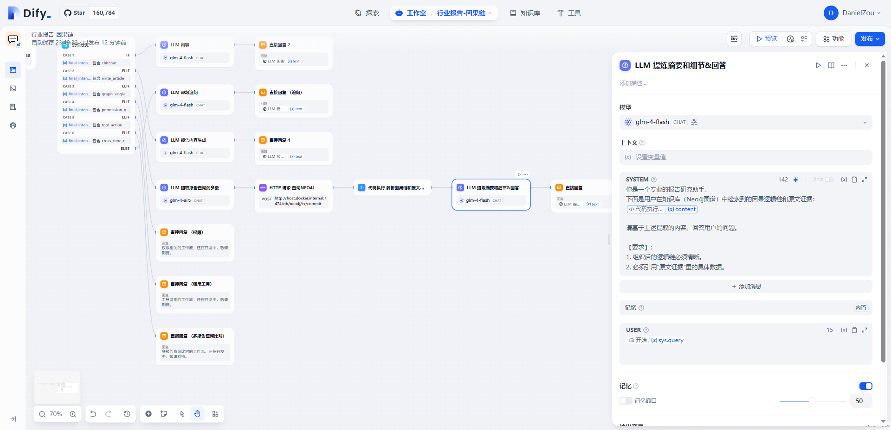
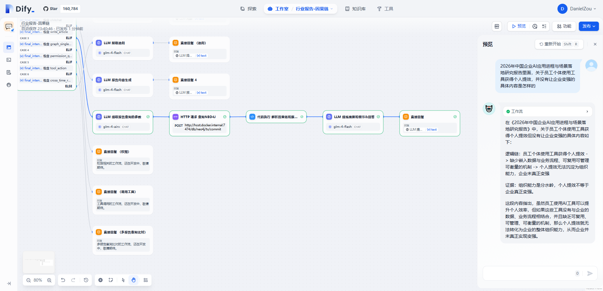

## 📌 痛点&对策
### 🎯 信息黑洞
- 之前的文章--[Markdown存入Neo4j构建图谱]()的总结里面提到，为了省 Token 对文档进行智能截断，喂给glm-5.3-flash大模型的只有前8000字和结尾2000字，导致大模型吐出来的文档摘要极有可能漏掉某些有用信息。

- 之前的文章--[Dify调用Agent生成Cypher语句查询图数据]()，提到在FastAPI（fileserver.py）里只获取了 Markdown 的前 12000 字，导致长报告的精华（往往是中间部分）直接丢失。

### 📕 因果图谱
- 要解决这两个问题，参考我自己在阅读研报时的做法（逐段思考该段的价值贡献逻辑），与其让大模型读一整篇全文进行一次性“概括”总结摘要，不如尝试让大模型逐段去“抽取”保留最硬的骨架逻辑。（毕竟大模型对长文经常犯 ***lost in middle*** 的“中间遗忘症”）
    - 入库端（ Python ）：把原来“只读头尾”的假的摘要提取，改成“全文切块提取 SVO 因果链”，存到Neo4j的是每一条 SVO 以及所有 SVO 串联起来的新摘要（因果链拼接体，仅仅作为文档属性存储，方便人去阅读和简单检索）。
    - 检索端（ Dify ）：把读前12000字原文，改成读新摘要（因果链拼接体）和某些 SVO 对应的原文 evidence 。

- 为了防止出现极度泛化的主语和宾语形成超级节点，存入 Neo4j 的要是合格的三元组，并且没有垃圾链将 Neo4j 撑爆，就需要进行 ***分层架构*** 和 ***清洗逻辑链***：
  - 底层（ JSON ）—— 负责“存底”与“全局检索”
    - 存什么：全量存储每一条因果链 logic_chain 和带有真实数据的 evidence（原文金句）。
    - 价值：***“金牌弹药库”*** 的存在。无论是直接拿 evidence 做语义匹配，还是把它按需投给 LLM 提炼洞察，都极其好用。
  - 表层（ Neo4j ）—— 负责“路径推导”与“精准打击”：
    - 存什么：只存剥离出来的具体实体节点（如“智能客服”、“录入时间”）和因果边（CAUSES）。
    - 边属性：在 CAUSES 边上挂载 logic_chain（局部的因果链）和 evidence（原文证据）。
    - 价值：极其清爽。利用 Cypher 做多跳路径查询（找神仙逻辑、找观点冲突等）时， Dify 顺着边一把捞出逻辑链和 evidence 证据，直接喂给 LLM 生成高质量的洞察，既快又准。
  - 逻辑链清洗包括：砍掉法务废话、免责声明、版权说明、无实质性的观点，砍掉过长的句子伪装成的实体、去重 subject + object 的字符串、清理 evidence 里面的 table / tr 表格标签等等。

## 🏋🏻‍♂️ 实践
### 【 核心链路 】：


### 1. 读取本地 MD 文件
- 沿用之前文章--[Markdown存入Neo4j构建图谱]()的成果，保留多份 MD 的断点续传、MD 和 PDF 以及 JSON 文件的自动归档等框架结构，新建一个 md2json.py 代码。

### 2. 切块（ Chunking ）
- 对单一 MD 文件按照每 2500 字，且重叠 500 字切块。为了防止文章实在太长，过渡消耗Token，仍然限制了最大 20 个Chunks（5万字）。

### 3. 循环调用 LLM 提炼 SVO 和因果链
- 考虑到 Meta 信息一般在对 First Chunk处理时就可以拿到，于是在循环调用 LLM 提炼 SVO 和因果链时，对 First Chunk 做特殊分支处理即可，避免过渡消耗 Token 。
- 提炼 SVO 和因果链的 Prompt 规则需要写的尽量规范，例如免责申明、法务说明、泛化的实体都要告诉 LLM 务必提取有价值的信息。


    <details markdown="1">
    <summary>👉 点击查看Prompt</summary>

    ```python
    # 因果链提取规则（作为公共任务）    
    chain_rules = f"""
    【因果链提取严格要求】：
    1. 必须是具体的业务、技术或市场影响，拒绝空话套话。
    2. **【实体约束（极其重要）】**：
        - `subject` 和 `object` 必须是**具体、可识别的实体**。
        - **严禁**使用以下过于宏观或抽象的词汇作为主语或宾语：`AI`、`AI工具`、`AI能力`、`AI应用`、`系统`、`业务`、`企业`、`时间`、`效率`、`功能`、`流程`、`收入`、`价值`。
        - 如果原文中只能提取出这种泛词，请结合上下文**替换为具体指代**（例如：不要写 `AI能力-提高-效率`，请根据原文改写为 `智能报价Agent-缩短-报价处理时效`）。如果实在无法具体化，请**放弃提取这一条**。
    3. `logic_chain` 必须包含清晰的箭头推导（如："大模型普及 -> 智能客服替代人工 -> 客服运营成本下降50%"）。
    4. `evidence` 必须是报告中支撑此观点的**原文原句**，且**必须带有具体数据或事实**，严禁包含双引号（"），如果原文有，请替换为单引号（'）或中文引号（“”）。
    5. 请忽略报告的开头（版权声明）和结尾（免责声明、免责条款、机构介绍）。绝对不要提取任何关于“本报告”、“编制机构”、“读者”、“投资建议”、“法律责任”的因果链。如果某个段落全是这类法务废话，请直接返回空列表 []。
    6. 如果遇到文本乱码、毫无逻辑的表格碎片或明显错位的句子，请直接忽略它们，不要强行提取因果链，宁可返回空列表 []。
    """
    ```

    </details>

- 另外，MinerU 转换后的 Markdown 里都有标题标识（#字符），通过正则表达式顺手把目录“抄”下来，作为文档节点的属性存进 Neo4j。（P_Document 节点上，再加一个 p_outline 的大纲属性）。如果用户问：“这篇报告讲了啥结构？”，在 Dify 意图识别为“查大纲”后，直接去 Dify 查 p_outline 即可。
    ```Cypher
    MATCH (d:P_Document {p_file: 'xxx'}) RETURN d.p_outline
    ```
    <details markdown="2">
    <summary>👉 点击查看单一 MD 文件的处理逻辑</summary>

    ```python
    # ================= 6. 单个文件处理核心逻辑 =================
    def process_single_file(file_path, filename):
        with open(file_path, 'r', encoding='utf-8') as f:
            content = f.read()

        # 1. 全文切块
        chunks = split_text(content, chunk_size=2500, overlap=200)
        
        # 限制最多处理前 20 块（约 5 万字），防止超长报告耗费太多 Token 和时间
        chunks = chunks[:20] 
        
        all_chains = []
        
        # 初始化默认 Meta，防止大模型没抽出来
        final_meta = {
            "p_title": filename,
            "p_year": None, 
            "p_doc_type": "其他", 
            "p_industry": "未知",
            "p_industry_group": "其他", 
            "p_publisher": None, 
            "p_region": None
        }

        # 2. 逐块提取因果链
        for j, chunk in enumerate(chunks):
            if len(chunk.strip()) < 200:
                continue
            
            print(f"      ⏳ 正在提取第 {j+1}/{len(chunks)} 块...", end="", flush=True)

            # 第一块Chunk投喂大模型，需要将Meta和这一Chunk的因果链都提炼出来
            is_first = (j == 0)
            result = extract_chunk(chunk, filename, is_first_chunk=is_first)

            # 只有第一块Chunk处理时才有 meta 字段，接住它
            if is_first and "meta" in result and result["meta"]:
                for k, v in result["meta"].items():
                    if v: # 只要不是 null，就替换
                        final_meta[k] = v

            # 所有的块都有 chains 字段，统统收集
            chain_count = len(result.get("chains", []))
            if "chains" in result and result["chains"]:
                all_chains.extend(result["chains"])
                print(f" ✅ 提取 {chain_count} 条")
            else:
                print(f" ➖ 无有效链条") 

            # 智谱 flash 并发限制，稍作延迟
            time.sleep(0.5) 

        # 3. 去重（基于 logic_chain 字段去重，防止重叠部分的重复提取）
        unique_chains = []
        seen_logic = set()
        for c in all_chains:
            if c.get("logic_chain") and c["logic_chain"] not in seen_logic:
                seen_logic.add(c["logic_chain"])
                unique_chains.append(c)

        # 4. 先调用清洗函数，得到干净的数据
        cleaned_list = clean_chains(unique_chains)

        if not cleaned_list:
            return None # 没提取到干货，直接跳过

        # 5. 用干净的因果链替代传统摘要，重新拼装 新summary（避免法务废话进摘要）
        clean_summary = "【全篇核心因果逻辑】：\n"
        for idx, c in enumerate(cleaned_list, 1):
            clean_summary += f"{idx}. {c.get('logic_chain', '')}\n"

        # 6. 提取去重后的关键词（只取清洗后的宾语） 简单粗暴把宾语提炼为关键词
        clean_keywords = list(set([c.get("object") for c in cleaned_list if c.get("object")]))[:10]

        # 7. 提取目录大纲（正则表达式）
        outline_text = extract_outline(content)

        # 8. 构建最终入库的 JSON 结构
        item = {
            "p_file": filename,
            "p_title": final_meta.get("p_title", filename),
            "p_year": final_meta.get("p_year"),
            "p_doc_type": final_meta.get("p_doc_type") or "其他",
            "p_industry": final_meta.get("p_industry") or "未知",
            "p_industry_group": final_meta.get("p_industry_group") or "其他",
            "p_publisher": final_meta.get("p_publisher"),
            "p_region": final_meta.get("p_region"),
            "p_outline": outline_text,
            "p_summary": clean_summary, # 👈 使用清洗后的拼接体
            "p_chains": cleaned_list,   # 👈 使用清洗后的链条
            "p_keywords": clean_keywords
        }
    
        return item
    ```

    </details>

- 最后再约束 LLM 按照下面的格式输出 JSON ：

    ```python
    ==================== 输出格式（严格 JSON） ====================
    只输出 JSON 对象，不要任何解释和代码块标记，不要包含任何其他闲聊文字，严格按照以下结构：
    {{
        "meta": {{
            "p_file": "{filename}",
            "p_title": "...",
            "p_year": 2026,
            "p_doc_type": "...",
            "p_industry": "...",
            "p_industry_group": "...",
            "p_publisher": "...",
            "p_region": "..."
        }},
        "chains": [
            {{
                "svo": "主语-谓语-宾语",
                "logic_chain": "A -> B -> C",
                "evidence": "原文带数据的句子",
                "subject": "具体主语",
                "object": "具体宾语"
            }}
        ]
    }}
    ```

- 如果 LLM 在提炼因果链时返回了错误格式的 JSON 体，需要尽量抢救挽回。就再包了一层例外捕获并强行提取的逻辑。

    <details markdown="2">
    <summary>👉 点击查看正则抢救的处理逻辑</summary>

    ```python
        try:
            response = client.chat.completions.create(
                model=MODEL_NAME,
                messages=[{"role": "user", "content": prompt}],
                temperature=0.1, # 低温度保证输出严谨
                # 智谱支持 JSON 模式，防止输出 Markdown 代码块
                response_format={"type": "json_object"} 
            )
            
            content = response.choices[0].message.content
            try:
                result = json.loads(content)
                
                # 兼容处理：大模型有时会包一层 {"data": [...]}
                if isinstance(result, dict):
                    # 直接返回字典，保留 meta 和 chains 的完整结构
                    return result
                elif isinstance(result, list):
                    # 极少数情况下大模型只返回了列表
                    return {"meta": {}, "chains": result}
                return {"meta": {}, "chains": []}

            except json.JSONDecodeError as e:
                print(f"[{filename}] JSON 格式损坏，启动正则抢救...")
                
                # 用正则强行把逻辑链和证据抠出来
                # 假设大模型输出了类似的："logic_chain": "xxx -> yyy"，"evidence": "zzz"
                salvaged_chains = []
                # 匹配主谓宾 (SVO)
                svo_matches = re.findall(r'"svo"\s*:\s*"(.*?)"', content)
                logic_matches = re.findall(r'"logic_chain"\s*:\s*"(.*?)"', content)
                evidence_matches = re.findall(r'"evidence"\s*:\s*"(.*?)"', content)
                subj_matches = re.findall(r'"subject"\s*:\s*"(.*?)"', content)
                obj_matches = re.findall(r'"object"\s*:\s*"(.*?)"', content)
                
                # 拼装抢救回来的数据
                for i in range(min(len(logic_matches), len(evidence_matches), len(subj_matches), len(obj_matches))):
                    salvaged_chains.append({
                        "svo": svo_matches[i] if i < len(svo_matches) else "",
                        "logic_chain": logic_matches[i],
                        "evidence": evidence_matches[i],
                        "subject": subj_matches[i],
                        "object": obj_matches[i]
                    })
                    
                print(f"[{filename}] 成功抢救出 {len(salvaged_chains)} 条残存因果链。")
                return {"meta": {}, "chains": salvaged_chains}
            
        except Exception as e:
            print(f"提取异常 [{filename}]: {e}")
            return {"meta": {}, "chains": []}
    ```

    </details>

- 考虑到切块后循环调用 LLM 一定会有时间等待，就用 tqdm 在后端对执行进度进行 tracking 。整个提取json字段的后端执行显示截屏如下：


### 4. 存入 Neo4j
- 沿用之前文章--[Dify调用Agent生成Cypher语句查询图数据]()的成果，保留多份 JSON 的批量合并、防同名等框架结构，新建一个 import2neo4j.py 代码。
- 对原有的200多篇文章节点，更新它们的 p_summary（变成因果链拼接体）和p_keywords、补全它们的 p_outline和 p_chains ，以及给它们长出新的 SVO 的 P_Entity 节点和 CAUSES 因果边。

    <details markdown="2">
    <summary>👉 点击查看Cypher入库的逻辑</summary>

    ```Cypher
    # ---------- Cypher 语句 ----------
    # 统一使用 P_ 作为节点标签前缀
    CYPHER_QUERY = """
    MERGE (d:P_Document {p_file: $p_file})
    // 🚨 使用 coalesce 防止新数据中为 null 时覆盖旧数据
    SET d.p_title = coalesce($p_title, d.p_title),
        d.p_year = coalesce($p_year, d.p_year),
        d.p_region = coalesce($p_region, d.p_region),
        d.p_summary = coalesce($p_summary, d.p_summary),
        d.p_pdf_path = coalesce($p_pdf_path, d.p_pdf_path),
        d.p_outline = coalesce($p_outline, d.p_outline),
        d.p_industry = coalesce($p_industry, d.p_industry)

    // 1. 关联文档类型
    MERGE (dt:P_DocType {p_name: $p_doc_type})
    MERGE (d)-[:BELONGS_TO_TYPE]->(dt)

    // 2. 关联行业大类
    MERGE (ig:P_IndustryGroup {p_name: $p_industry_group})
    MERGE (d)-[:BELONGS_TO_GROUP]->(ig)

    // 3. 关联细粒度行业
    MERGE (ind:P_Industry {p_name: $p_industry})
    MERGE (d)-[:BELONGS_TO_INDUSTRY]->(ind)

    // 4. 关联发布机构 (防止因 null 导致建节点失败)
    WITH d
    FOREACH (ignoreMe IN CASE WHEN $p_publisher IS NOT NULL AND $p_publisher <> '' THEN [1] ELSE [] END |
        MERGE (p:P_Publisher {p_name: $p_publisher})
        MERGE (d)-[:PUBLISHED_BY]->(p)
    )

    // 5. 关联关键词
    WITH d
    UNWIND $p_keywords AS kw_name
    MERGE (k:P_Keyword {p_name: kw_name})
    MERGE (d)-[:HAS_KEYWORD]->(k)

    // 6. 新增核心：写入因果链 (SVO)
    WITH DISTINCT d
    UNWIND $p_chains AS chain
    // 建立主语实体
    MERGE (s:P_Entity {p_name: chain.subject})
    // 建立宾语实体
    MERGE (o:P_Entity {p_name: chain.object})

    // 建立 CAUSES 关系，并挂载证据
    MERGE (s)-[r:CAUSES]->(o)
    SET r.p_logic_chain = chain.logic_chain,
        r.p_evidence = chain.evidence,
        r.p_source_file = d.p_file

    // 把实体和文档关联起来，方便从文档反查实体
    MERGE (d)-[:MENTIONS]->(s)
    MERGE (d)-[:MENTIONS]->(o)
    """
    ```
   </details>

- 执行完 import2neo4j.py 程序后，为了看看LLM提炼后的因果链，在Neo4j里面的展示效果如何，摘选了一篇文章并用Neo4j Browser查了一下：


    - 从第 1、2 行数据可以看到都在讲“首批试点”应该怎么选（选低风险、选左上象限），打开原 PDF 核对了一下，结果令我甚是欣慰。👍
        

    - 再看第 5 行："员工个体使用工具获得个人提效 -> 缺少嵌入数据与业务流程、可复用可管理可衡量的机制 -> 个人提效无法沉淀为组织能力，企业未真正变强"，打开原PDF搜索关键词核对，结果依然让人觉得OK。👍
        

    - 顿时体会到了全文切块 + LLM 提炼 SVO 和因果链是一条可行之路！🌻 Maybe，图谱的威力也不止我想象得到的以下两种：😇
      - **网状连接能力（Merge 的威力）**：比如第 3、4 行，都指向了终点 “重复劳动”；第 5 行指向了 “组织级能力”。如果以后有其他报告也提到了 “组织级能力”，图谱就会自动把这两篇报告“缝合”在一起。这就是跨报告观点比对的基础。
      - **长链推导（跨节点追踪）**：假设执行一个 2 跳或 3 跳的查询，比如：
        ```Cypher
        MATCH p=(a)-[:CAUSES*1..3]->(b {p_name: "组织级能力"}) RETURN p
        ```
        图谱应该会查出来多跳的因果链，不仅“员工个人提效”会导致它，还有“治理机制缺位”、“场景无owner”等因素。

### 5. Dify 深挖文档（查 Neo4j ）
- 沿用之前文章--[自建IntentRouting分类器]()的成果，复制【行业报告-意图路由】的工作流，新建工作流：【行业报告-因果链】。将节点【LLM 提取报告查询的参数】后面的节点改为：HTTP 查询 Neo4j -> 代码执行 解析因果链和原文证据 -> LLM 提炼摘要和细节&回答。这样通过 Neo4j 返回："全篇因果链" + 命中切片处的证据"evidence"原文。极大的减少了 Token 的消耗。
- HTTP 请求查询 Neo4j的 Cypher如下：
    
- 代码执行 解析因果链和原文证据的节点，解析上一节点返回 JSON 体：
    

### 6. LLM 提炼并回答
- 写一小段 Prompt 给到 LLM ：
    
- 沿用上面的那篇《2026年中国企业AI应用进程与场景落地研究报告》文章，预览验证了一下，效果还挺ok的。👍
    

## 📝总结（踩过的坑）
### 1. 头尾截断法，把精华全丢了
- 彻底废弃头8000+尾2000的截断做法，改用全文切块（Chunking，带 200 字重叠） + 分块提取因果链，最后用因果链强制拼接成全新的 p_summary，保证 100% 覆盖了全文核心信息。
### 2. 大模型“放飞自我”，生成泛词废节点
- 在 Prompt 中加上极度严苛的负面清单（严禁使用 AI/系统/效率等词），强制要求具象化实体，跳过免责声明等无价值的文本；并在 Python 端加上正则过滤等处理，把垃圾挡在门外。无论如何，evidence 原文是否能让人读得通顺，这才是关键。
### 3. 从“让 AI 写摘要”变成了“让 AI 抽因果骨架”
- 看到AI这种***“直击要害且带原文背书”***的回答，再比对传统的 RAG（切片检索）只会在原文再自编一堆废话，明显认知上又有了一个迭代，那些纯粹的因果真相，才是AI效率化的价值。