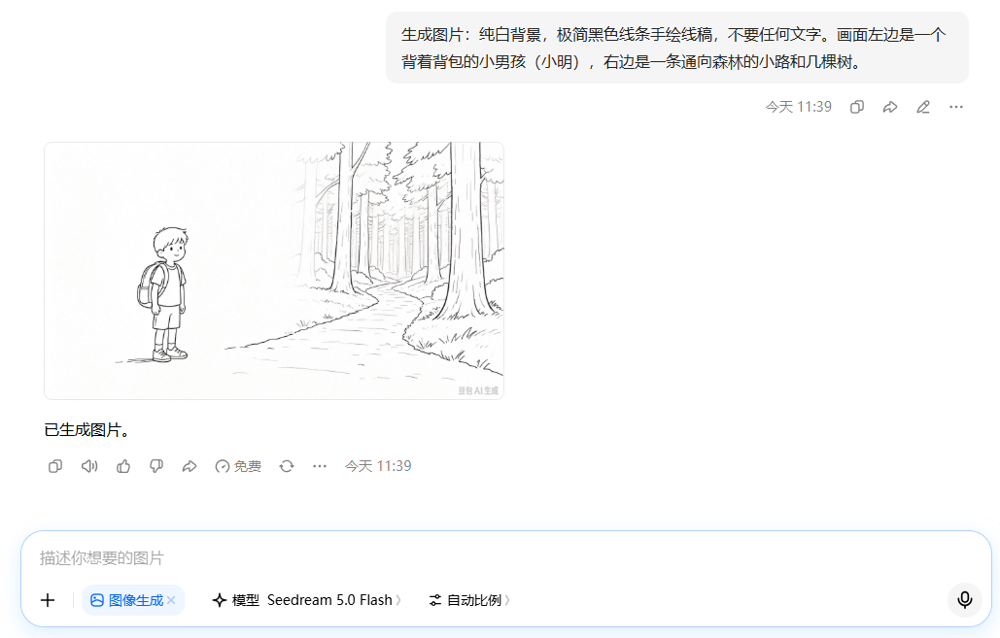
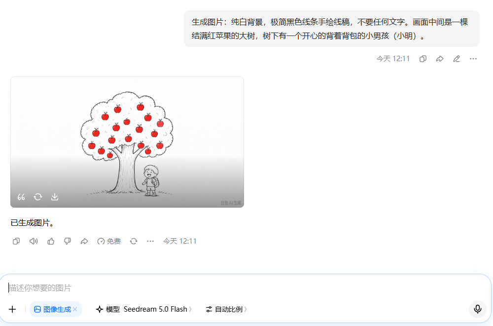
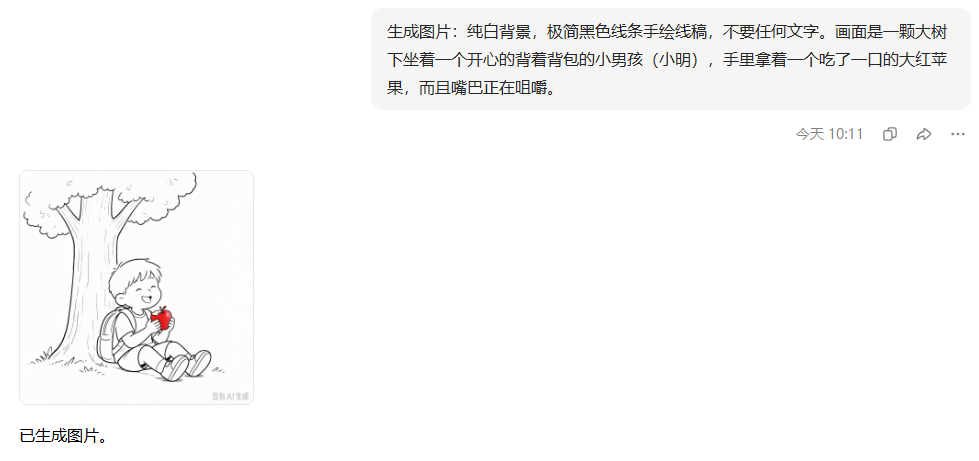
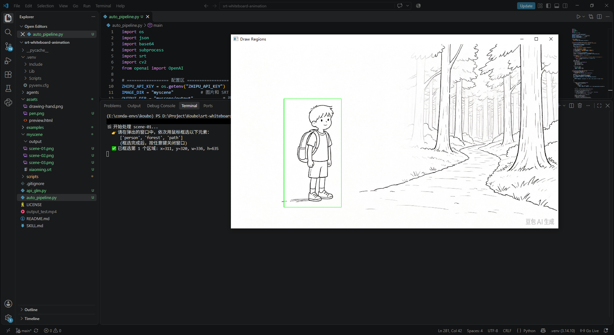

## 📌 核心架构
- 文案与生图： 根据 srt 字幕编写提示词到 AI 网页版生成图片（0 Token 白嫖）。

- 编写一键生成视频的 Python 代码，核心功能：
  - 自动解析 SRT 的时间轴，按分镜顺序读白嫖生成的图片。
  - 把分镜字幕和图片，发给智谱 GLM-4.1V（免费），获取返回的画面核心要素的粗略坐标（如 person, tree），利用本地 OpenCV 自动精修坐标。
  - 防止 AI 框偏坐标，界面弹出分镜画面，由人工进行极简的鼠标框选动作（几秒钟解决重叠、白块等疑难杂症）。利用精准的坐标，自动填入规范的 Json 模板。
  - 自动调用 render_stream_whiteboard.py，以 --ink-path skeleton（骨架贴合）和 --color-fill contour-wipe（轮廓上色）的方式，渲染出各分镜独立的视频。
  - 自动生成 FFmpeg 的拼接清单，自动将各分镜视频无缝拼接，配上 SRT 字幕，输出成品。

- 渲染与合成：本地 Python 自动化脚本 auto_pipeline.py 一键跑通。

## 🧱 实践步骤 

### 1. 环境准备

- 克隆仓库：
  ```
  git clone https://github.com/geeklee/srt-whiteboard-animation.git
  ```
- 进入仓库目录，运行环境准备脚本：
  ```
  cd srt-whiteboard-animation
  python scripts/prepare_env.py --check
  python scripts/prepare_env.py
  ```
  完成后记下输出的内容： ENV_PY=D:\Project\Koubo\srt-whiteboard-animation\.venv\Scripts\python.exe
- 安装必要的库：
  ```
  .\.venv\Scripts\pip.exe install srt openai ffmpeg 
  ```
### 2. 准备字幕文件

- 建一个srt字幕文件： xiaoming.srt
  ```
  1
  00:00:00,000 --> 00:00:03,000
  在一个阳光明媚的早晨，小明决定去森林里探险。
  
  2
  00:00:03,500 --> 00:00:07,000
  他走着走着，突然发现路边有一棵结满红苹果的大树。
  
  3
  00:00:07,500 --> 00:00:11,000
  小明兴奋地跑过去，摘下一个最大的苹果尝了一口。
  ```
### 3. 白嫖豆包文生图（网页版）
- 发送提示词，让豆包生成三份线稿图，并保存到 myscene 文件夹下：（scene-01.png、scene-02.png、scene-03.png）




### 4. 编写 Python 代码（auto_pipeline.py）
- 核心功能一：智能吸附（ auto_refine_region ）。利用二值化和轮廓检测，精准锁定线条边界。

- 核心功能二：多模态调用（ get_rough_coords_from_glm ）。Base64 传图，Prompt 约束，配合正则清洗。

- 核心功能三：人工质检（ get_manual_regions ）。基于 OpenCV 鼠标事件，实时反馈拖拽框线。

- 核心功能四：数据装配（ process_scene ）。自动读取图片尺寸，按时间比例分配动画时长，强制规范渲染 JSON，并拉起本地渲染进程，生成单一分镜视频。如果不需要人工框选坐标， MANUAL_MODE 改为 false 。

- 主函数：按照 SRT 字幕文件拆分镜，按分镜头循环，将每一分镜的文字、时间段、图片传给 process_scene 去调用 get_rough_coords_from_glm 获取智谱识图大模型返回的粗坐标、核心元素等 JSON 格式的 elements，然后用 ffmpeg 将 process_scene 生成的各分镜视频合并，最后配上字幕。

    <details markdown="1">
    <summary>👉 点击查看 auto_pipeline.py 代码</summary>

    ```python
    import os
    import json
    import base64
    import subprocess
    import srt
    import cv2
    from openai import OpenAI

    # ================= 配置区 =================
    ZHIPU_API_KEY = os.getenv("ZHIPU_API_KEY")
    IMAGE_DIR = "myscene"           # 图片和 SRT 存放的目录
    OUTPUT_DIR = "myscene/output"            # 视频输出目录
    SRT_FILE = "myscene/xiaoming.srt"   # 字幕文件
    HAND_IMAGE = "assets/pen.png"
    # =========================================

    client = OpenAI(
        api_key=ZHIPU_API_KEY,
        base_url="https://open.bigmodel.cn/api/paas/v4",
    )

    # ================= 核心工具 1：OpenCV 精修坐标 =================
    def auto_refine_region(image_path, rough_region, padding=20, retry_count=0):
        """
        根据大模型给的大致坐标，用 OpenCV 找真实的线条边缘。
        如果没找到，自动扩大搜索范围重试。
        """
        img = cv2.imread(image_path)
        if img is None:
            raise FileNotFoundError(f"找不到图片: {image_path}")
            
        x = max(0, rough_region["x"] - padding)
        y = max(0, rough_region["y"] - padding)
        w = min(img.shape[1] - x, rough_region["width"] + padding * 2)
        h = min(img.shape[0] - y, rough_region["height"] + padding * 2)
        roi = img[y:y+h, x:x+w]
        
        gray = cv2.cvtColor(roi, cv2.COLOR_BGR2GRAY)
        _, thresh = cv2.threshold(gray, 200, 255, cv2.THRESH_BINARY_INV)
        contours, _ = cv2.findContours(thresh, cv2.RETR_EXTERNAL, cv2.CHAIN_APPROX_SIMPLE)
        
        # 如果没找到线条，且重试次数小于 3 次，扩大范围再找
        if not contours:
            if retry_count < 3:
                return auto_refine_region(image_path, rough_region, padding + 50, retry_count + 1)
            else:
                print("  ⚠️ 扩大范围后依然没找到线条，使用原始大模型坐标。")
                return rough_region

        x_min, y_min = w, h
        x_max, y_max = 0, 0
        for cnt in contours:
            bx, by, bw, bh = cv2.boundingRect(cnt)
            x_min = min(x_min, bx)
            y_min = min(y_min, by)
            x_max = max(x_max, bx + bw)
            y_max = max(y_max, by + bh)
            
        return {
            "x": int(x + x_min),
            "y": int(y + y_min),
            "width": int(x_max - x_min),
            "height": int(y_max - y_min)
        }

    # ================= 核心工具 2：调用 GLM 视觉模型 =================
    def get_rough_coords_from_glm(image_path, text):
        """调用 GLM 视觉模型获取粗略坐标"""
        with open(image_path, "rb") as f:
            img_base64 = base64.b64encode(f.read()).decode("utf-8")

        prompt = f"""
        这是一张白板动画的线稿图。对应的字幕文本是：“{text}”。
        请观察图片，找出画面中与字幕相关的 2-4 个核心元素。
        给出它们**大致的**矩形包围框（x, y, width, height）。
        严格输出纯 JSON 格式，不要包含任何 ```json 标记，也不要有任何解释文字。
        {{
        "elements": [
            {{"id": "元素英文名", "rough_region": {{"x": 100, "y": 200, "width": 50, "height": 50}}}}
        ]
        }}
        """
        
        try:
            response = client.chat.completions.create(
                model="glm-4.1v-thinking-flash",
                messages=[{
                    "role": "user",
                    "content": [
                        {"type": "text", "text": prompt},
                        {"type": "image_url", "image_url": {"url": f"data:image/png;base64,{img_base64}"}}
                    ]
                }]
            )
            result_text = response.choices[0].message.content.strip()
            
            # ================= 新增的清洗逻辑 =================
            # 如果大模型带了 markdown 代码块，直接把它切掉
            if "```json" in result_text:
                result_text = result_text.split("```json")[1].split("```")[0].strip()
            elif "```" in result_text:
                result_text = result_text.split("```")[1].strip()
                
            # 找到第一个 { 和最后一个 }，把前后的废话全砍掉
            start_idx = result_text.find("{")
            end_idx = result_text.rfind("}")
            if start_idx != -1 and end_idx != -1:
                result_text = result_text[start_idx:end_idx+1]
            # ==================================================
            
            return json.loads(result_text)
            
        except Exception as e:
            print(f"  ⚠️ GLM API 调用失败或解析失败: {e}")
            return {"elements": []}

    # ================= 核心工具 3：半自动人工框选坐标 =================
    def get_manual_regions(image_path, expected_count):
        """弹窗让用户手动框选指定数量的区域"""
        img = cv2.imread(image_path)
        clone = img.copy()
        regions = []
        
        # 这里初始化 ix, iy 和 drawing
        ix, iy = -1, -1
        drawing = False
        
        def draw_rectangle(event, x, y, flags, param):
            nonlocal clone, ix, iy, drawing, regions
            
            if event == cv2.EVENT_LBUTTONDOWN:
                drawing = True
                ix, iy = x, y
                
            elif event == cv2.EVENT_MOUSEMOVE:
                if drawing:
                    # 拖拽时实时显示线框
                    temp_img = clone.copy()
                    cv2.rectangle(temp_img, (ix, iy), (x, y), (0, 255, 0), 2)
                    cv2.imshow("Draw Regions", temp_img)
                    
            elif event == cv2.EVENT_LBUTTONUP:
                drawing = False
                # 重新画一遍，把之前的框保留下来
                cv2.rectangle(clone, (ix, iy), (x, y), (0, 255, 0), 2)
                cv2.imshow("Draw Regions", clone)
                
                x_min, x_max = min(ix, x), max(ix, x)
                y_min, y_max = min(iy, y), max(iy, y)
                w, h = x_max - x_min, y_max - y_min
                regions.append({"x": x_min, "y": y_min, "width": w, "height": h})
                print(f"  ✅ 已框选第 {len(regions)} 个区域: x={x_min}, y={y_min}, w={w}, h={h}")
                
                if len(regions) >= expected_count:
                    print(f"  🎉 所有 {expected_count} 个区域框选完毕！")
                    # 延时一下让用户看清最后一个框，然后自动关闭
                    cv2.waitKey(500)
                    cv2.destroyAllWindows()

        cv2.namedWindow("Draw Regions", cv2.WINDOW_NORMAL)
        cv2.setMouseCallback("Draw Regions", draw_rectangle)
        cv2.imshow("Draw Regions", clone)
        
        while True:
            # 增加一个退出机制，如果用户直接关了窗口或者按了 ESC，就强行结束
            if cv2.waitKey(10) & 0xFF == 27:
                break
            if cv2.getWindowProperty("Draw Regions", cv2.WND_PROP_VISIBLE) < 1:
                break
                
        cv2.destroyAllWindows()
        return regions

    # ================= 核心流程：处理单幕场景 =================
    def process_scene(scene_idx, image_path, text, duration_ms):
        scene_id = f"scene-{scene_idx:02d}"
        print(f"\n🎬 开始处理 {scene_id}...")
        
        # 1. 读取图片尺寸
        img = cv2.imread(image_path)
        img_h, img_w = img.shape[:2]
        
        # 2. 询问 GLM 获取粗坐标
        glm_data = get_rough_coords_from_glm(image_path, text)
        if not glm_data.get("elements"):
            print(f"  ⚠️ 模型未返回有效元素，跳过此幕。")
            return None
            
        final_elements = []
        current_time = 0
        duration_per_element = int(duration_ms / len(glm_data["elements"]))
        
        # ==================== 手动兜底模式 ====================
        # 如果想全自动，把这里设为 False；如果你想完美画面，设为 True
        MANUAL_MODE = True 
        
        if MANUAL_MODE:
            print(f"  👉 请在弹出的窗口中，依次用鼠标框选以下元素：")
            print(f"      {[item['id'] for item in glm_data['elements']]}")
            print(f"      (框选完成后，按任意键关闭窗口)")
            manual_regions = get_manual_regions(image_path, len(glm_data["elements"]))
        else:
            manual_regions = []
        # ====================================================

        for i, item in enumerate(glm_data["elements"]):
            print(f"  🔍 正在处理元素: {item['id']}")
            
            # 如果手动框选了，直接用；否则用 OpenCV 修复
            if MANUAL_MODE and i < len(manual_regions):
                precise_region = manual_regions[i]
            else:
                # 扩大搜索范围，以防 AI 框偏
                precise_region = auto_refine_region(image_path, item["rough_region"], padding=50)
                
            # ... 下面的组装 JSON 逻辑保持完全不变 ...
            element = {
                "id": item["id"],
                "label": item["id"],
                "sequence": i + 1,
                "narrativeRole": "元素",
                "subtitle": "",
                "type": "structure",
                "region": precise_region,
                "reveal": {
                    "direction": item.get("direction", "top_to_bottom"),
                    "startMs": current_time,
                    "durationMs": duration_per_element,
                    "maskPaddingPx": 10
                },
                "handPath": {
                    "start": [precise_region["x"] + precise_region["width"]//2, precise_region["y"]],
                    "end": [precise_region["x"] + precise_region["width"]//2, precise_region["y"] + precise_region["height"]],
                    "easing": "easeInOut"
                }
            }
            final_elements.append(element)
            current_time += duration_per_element
            
        final_json = {
            "sceneId": scene_id,
            "canvas": {"width": img_w, "height": img_h}, # 自动读取当前图片的尺寸
            "sceneDurationMs": duration_ms,
            "elements": final_elements
        }
        
        json_path = os.path.join(OUTPUT_DIR, f"{scene_id}.annotation.json")
        with open(json_path, "w", encoding="utf-8") as f:
            json.dump(final_json, f, ensure_ascii=False, indent=2)
            
        video_path = os.path.join(OUTPUT_DIR, f"{scene_id}.mp4")
        render_cmd = [
            ".venv\\Scripts\\python.exe", "scripts\\render_stream_whiteboard.py",
            image_path, json_path, video_path, HAND_IMAGE,
            "--ink-path", "skeleton", "--color-fill", "contour-wipe"
        ]
        subprocess.run(render_cmd, check=True)
        return video_path

    # ================= 主函数 =================
    def main():
        os.makedirs(OUTPUT_DIR, exist_ok=True)
        
        with open(SRT_FILE, "r", encoding="utf-8") as f:
            subtitles = list(srt.parse(f.read()))
            
        video_list = []
        for i, sub in enumerate(subtitles):
            scene_idx = i + 1
            image_path = os.path.join(IMAGE_DIR, f"scene-{scene_idx:02d}.png")
            
            if not os.path.exists(image_path):
                print(f"❌ 找不到图片: {image_path}，跳过。")
                continue
                
            duration_ms = int((sub.end - sub.start).total_seconds() * 1000)
            text = sub.content
            
            video_path = process_scene(scene_idx, image_path, text, duration_ms)
            if video_path:
                video_list.append(video_path)
                
        if video_list:
            print("\n🔗 开始拼接并加字幕...")
            concat_file = os.path.join(OUTPUT_DIR, "concat_list.txt")
            with open(concat_file, "w", encoding="utf-8") as f:
                for vp in video_list:
                    f.write(f"file '{os.path.abspath(vp)}'\n")
                    
            merged_path = os.path.join(OUTPUT_DIR, "merged_temp.mp4")
            subprocess.run([
                "ffmpeg", "-y", "-f", "concat", "-safe", "0", "-i", concat_file,
                "-vf", "scale=1920:1080:force_original_aspect_ratio=decrease,pad=1920:1080:(ow-iw)/2:(oh-ih)/2:color=white",
                "-c:v", "libx264", "-crf", "23", "-preset", "fast",
                merged_path
            ], check=True)
            
            final_out = os.path.join(OUTPUT_DIR, "final_output.mp4")
            subprocess.run([
                "ffmpeg", "-y", "-i", merged_path, 
                "-vf", f"subtitles={SRT_FILE}:force_style='FontName=Microsoft YaHei,FontSize=20,PrimaryColour=&H00FFFFFF,OutlineColour=&H00000000,BorderStyle=1,Outline=2,Shadow=1,MarginV=30'",
                "-c:a", "copy", final_out
            ], check=True)
            print(f"🎉 全自动生成完毕！最终视频: {final_out}")

    if __name__ == "__main__":
        main()

    ```

    </details>

### 5. 执行 auto_pipeline.py

- VSCODE的Terminal里面直接执行：
    ```
    .\.venv\Scripts\python.exe .\auto_pipeline.py
    ```

- 因为开启了 MANUAL_MODE ，每个分镜都需要人工对图片元素进行坐标框选，按照提示操作：


- 完成后的成品：
<video src="/assets/images/Srt2MP4/final_output.mp4" controls width="100%" playsinline></video>

## 📝 总结
- 大模型“懂语义，不懂像素”，导致大模型框出的坐标经常偏得离谱，甚至只有几个像素大小。所以，利用 OpenCV 的 cv2.findContours 在 AI 给定的粗略区域周围“找线条”。如果找不到，自动扩大搜索范围重试（最多3次），实现自动容错兜底。在精度仍然不可靠时，利用 OpenCV 的 GUI 交互，人工用鼠标拖拽框选元素的坐标来兜底。
- 大模型输出格式不稳定（JSON 幻觉），经常带 \`\`\`json代码块，甚至加废话，导致 json.loads 时 直接崩溃。所以，在调用 get_rough_coords_from_glm 的最后，增加严格的清洗逻辑。通过字符串截取 { 和 } 之间的内容，确保拿到纯 JSON 。