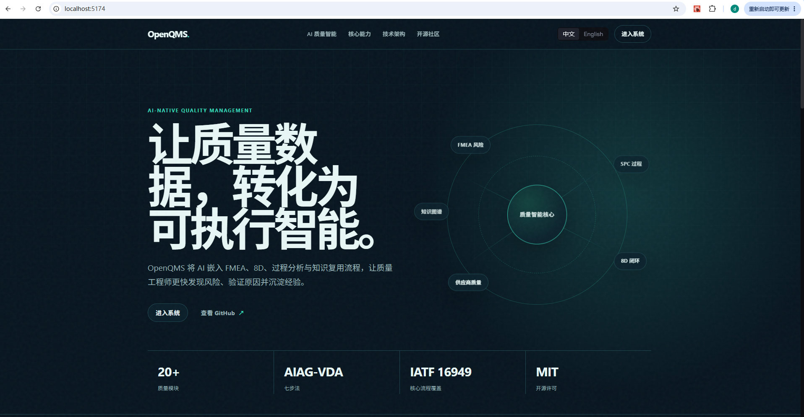
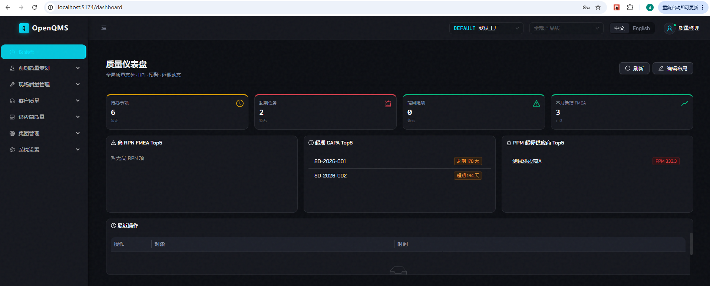
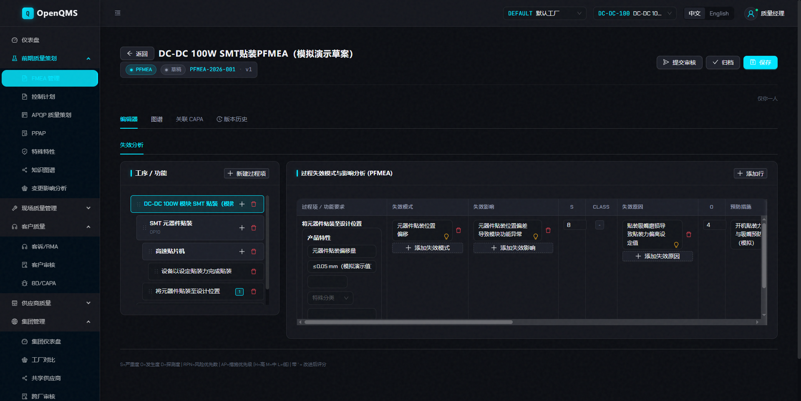
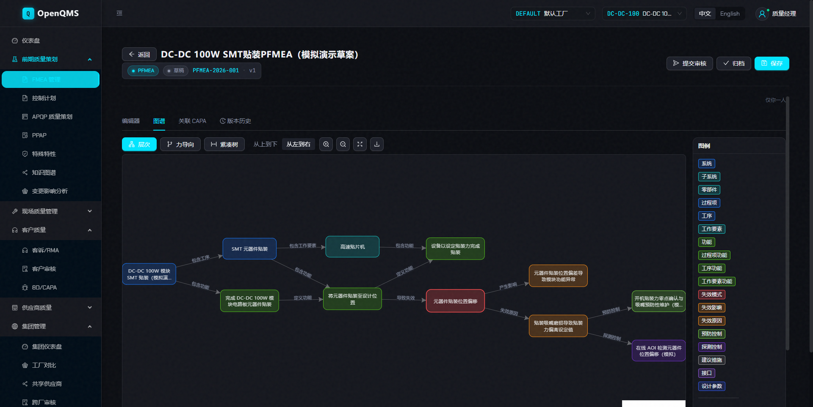
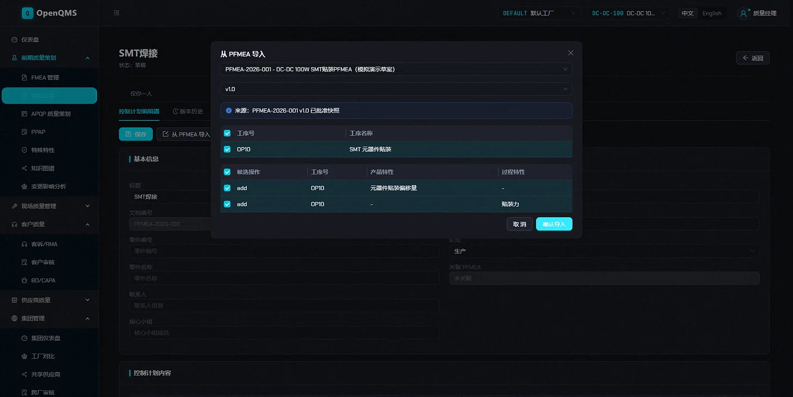
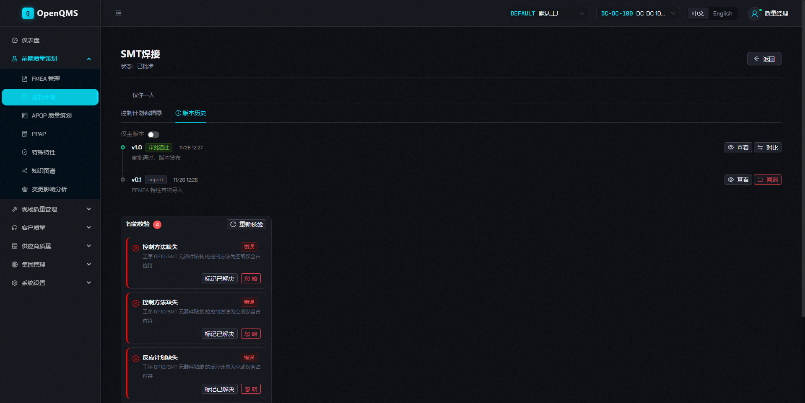
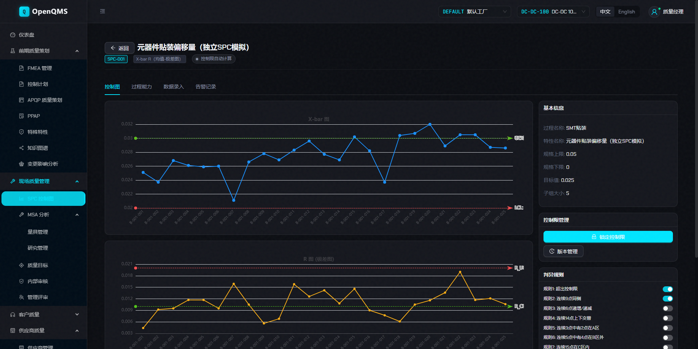

## 📌 环境准备
1. VSCode 中建立 OpenQMS 文件夹，Terminal 中用 Git 命令克隆仓库：
   ```
   (base) PS D:\Project\OpenQMS> git clone https://github.com/Open-Industry-System/OpenQMS.git           
   ```
2. 因为不体验 AI 模块，先复制一份 .env.example 存成 .env ，然后在最后添加环境变量,并删除和 ollama 以及 agent 有关的所有节点。
   ```
   AGENT_ATTACHMENT_BROWSER_NONCE=test-nonce-12345
   ```
3. 为了不和原有的 Docker 中的 Redis 、PostgreSQL、Neo4j 等的端口冲突，打开docker-compose.yml，将相应的端口映射做了调整：
   ```
   db: 下面的 ports:，把 "5432:5432" 改成 "5433:5432"
   redis: 下面的 ports:，把 "6379:6379" 改成 "6380:6379"
   neo4j: 下面的 ports:，把 "7474:7474" 改成 "7475:7474"，把 "7687:7687" 改成 "7688:7687"
   backend: 下面的 ports:，把 "8000:8000" 改成 "8090:8000"
   frontend: 下面的 ports:，把 "5173:5173" 改成 "5174:5173"
   ```
   
4. 打开 Docker Desktop，回到Terminal中运行docker一键安装的命令：
   ```
   docker compose up -d
   ```
   等下载镜像、安装容器、启动容器，全部完成，可以打开浏览器输入：http://localhost:5174 ,进入登陆界面。
      

5. 初始化数据库并导入演示账号
   ```
   docker compose exec backend alembic upgrade head
   docker compose exec backend python -m app.seed
   ```
   等全部执行完成，Terminal中输出账号信息：
   ```
   Demo users: engineer/Engineer@2026, manager/Manager@2026, viewer/Viewer@2026. Initialize admin/groupadmin privately: python -m app.cli.bootstrap_admin --username admin --replace-existing
   ```
6. 使用 manager 账号登陆系统：
      

7. 在8D里面找个关联好的 PFMEA 编号（PFMEA-2026-001），链接到 FMEA 管理界面，就能查看到图谱了。
      
      

8. 针对这个 PFMEA 提交审批并批准后，到控制计划进行导入确认。
     
     

9. 点开现场质量管理的SPC控制图，查看到的6区8准则都丝滑呈现。👍
      

## 📝 总结
- 非常不错的开源宝藏，在“新品可靠量产”、“客户风险围堵”、“过程波动前移”的功能匹配度上看，相关模块做得挺完整了，必须点亮Star⭐。还有很多要学习的内容，后面再细细研究试用起来。
- FMEA 图谱、SPC 判异、Cp/Cpk 计算、MSA 量具管理，直接贴合了 IATF 16949 的核心方法论。就是针对防篡改要求，还没有找到一键发起“工程变更（ECN）”的入口。可能是周边系统集成过来的吗？后面再继续学习研究。
- 有一个老生常谈的话题：越是专业的软件越难用。按照我20多年项目的经验，还是那句话：系统用不好的最大阻力是强制要求工程师必须按规范去建数据。😄