## 📌 环境准备

### 1. 意图路由的框架

- 路由就是定义处理能力（分支动作），将无穷的提问意图归结到要不要查库，查库要查几个（Single/Multi），要不要追问用户，要不要人工介入等等。只有**被约束、被度量、被回滚**的路由才是稳定可靠的，再加上希望节省 Token 、低延迟，于是放弃直接全盘靠LLM路由的想法，自建一套简单的轻量级的判别式的分类器。
- 路由决策必须带上：模型版本、阈值版本、边界定义、决策理由，保证能被回溯。
- 路由要给一个拒识的分支出口：低置信、模糊不清的意图还得转 LLM 追问或转人工。
- 路由还要有一个固定的回归测试集，在调优时能比对模型版本和阈值变化前后的指标。
- 路由的结果一定是一个可校准的概率分布。（有时候靠阈值校准来降低高风险，而模型输出的置信度稍低也OK）
- 分类器只负责判断 ***“该走哪条路”*** ， 判断结果要严格约束为分类标签（JSON），在 Dify 的条件分类节点来承接并往相应的分支上流转。

### 2. 意图类别的分类标签设计
| **意图分类标签**           | **意图说明**                       | **后续处理**                                            |
| :------------------------- | :--------------------------------- | :------------------------------------------------------ |
| ***chitchat***             | 与知识库无关的闲聊                 | LLM 直接回复，不查知识库                                |
| ***graph_single_query***   | 查询某篇文章内容、细节、归档路径   | 模板化 Cypher + 关键词填充 → Neo4j → FastAPI → LLM 总结 |
| ***cross_time_retrieval*** | 跨时间段检索后混合查询             | 时间条件提取 → 分步查询 → 合并结果                      |
| ***write_article***        | 想写某主题文章，参考知识库现有文档 | 检索相关文档作为素材 → 输出写作框架/草稿                |
| ***tool_action***          | 要求执行外部动作                   | 调用对应工具/API                                        |
| ***permission_query***     | 询问权限、安全控制范围             | 查询权限配置或返回预设的回复                            |
| ***fallback_clarify***     | 参数不全、意图模糊、置信度低       | 向用户追问确认                                          |

### 3. 模块实现
#### 3.1 离线端：***模型训练***
- **整体流程**：数据准备 → 训练 → 校准 → 评测 → 导出
- **数据准备**：
  - 目录结构：
    ```
    router_offline/
    ├── data/
    │   ├── train.csv                # 训练数据: query,intent
    │   └── eval_set.json            # 固定回归测试集: [{"query":"...", "expected_intent":"..."}]
    ├── models/
    │   ├── router_v1.2.0_embedding_large.pkl      # 训练产出的模型
    │   └── config_v1.2.0_embedding_large.json     # 模型版本、阈值版本、类别列表、校准信息
    ├── src/
    │   ├── trainEmbeddingLarge.py   # 训练 + 概率校准 + 保存模型
    │   └── evaluate.py              # 跑回归测试集，输出指标
    └── requirements.txt
    ```
  - 训练数据：
  CSV 文件里面就2个字段（query：提问,intent：意图分类标签），每个intent至少10条，共600条，再写端python打乱行序，注意要用 UTF-8 编码保存。
  - 回归验证集：
  JSON 数据共 200 条，每个 intent 分支差不多准备 30 条左右。

- 安装 Scikit-learn,  Joblib， SentenceTransformer 的库，参考了之前备考《高级人工智能训练师》时的模型训练代码，加上中文字符的特殊清洗处理，执行代码trainEmbeddingLarge.py，训练并校准模型。再执行evalute.py进行评测模型，输出的模型准确率: 0.8000、Fallback Rate (拒识率): 25.00%，F1-score 0.66，可以说结果还挺不错的，毕竟不到三分之一的问题直接过滤了，可以省不少Token费用。😎
  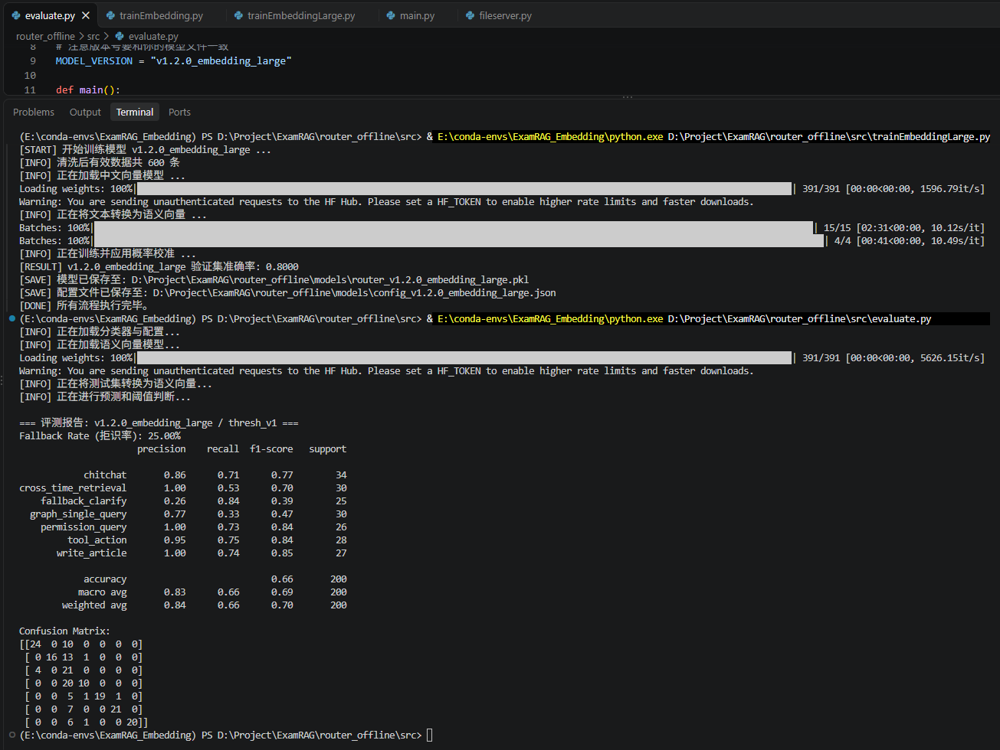
  
    <details markdown="1">
    <summary>👉 点击查看trainEmbeddingLarge.py代码</summary>

    ```python
    import json
    import os
    import joblib
    import pandas as pd
    import re
    from sklearn.linear_model import LogisticRegression
    from sklearn.calibration import CalibratedClassifierCV
    from sklearn.model_selection import train_test_split
    from sentence_transformers import SentenceTransformer

    # ================= 1. 全局配置 =================
    MODEL_VERSION = "v1.2.0_embedding_large" # 升级版本号，使用了 Embedding 语义向量

    VALID_INTENTS = [
        "chitchat", "graph_single_query", "cross_time_retrieval", 
        "write_article", "tool_action", "permission_query", "fallback_clarify"
    ]

    def main():
        print(f"[START] 开始训练模型 {MODEL_VERSION} ...")
        # 动态定位到当前脚本所在的 router_offline 目录
        current_dir = os.path.dirname(os.path.abspath(__file__)) # src 目录
        router_offline_dir = os.path.dirname(current_dir)        # router_offline 目录

        # 拼接正确的 train.csv 路径
        data_path = os.path.join(router_offline_dir, "data", "train.csv")
        
        # ================= 2. 数据读取与清洗 =================
        # names=[...], header=None: 强制指定列名，防止 CSV 文件自带的表头干扰解析
        # on_bad_lines='skip': 遇到格式严重损坏的行（如多出很多逗号）直接跳过，防止报错中断
        df = pd.read_csv(data_path, names=["query", "intent"], header=None, on_bad_lines='skip')
        
        # 剔除可能残留在数据里的表头行（即文件中本身写了一行 "query,intent"）
        df = df[df["query"] != "query"]
        # 剔除不在 7 个合法意图内的脏数据
        df = df[df["intent"].isin(VALID_INTENTS)] 
        # 剔除空值，并按 query 去重
        df = df.dropna(subset=["query", "intent"]).drop_duplicates(subset=["query"])
        
        # 文本清洗函数
        def clean_text(text):
            text = str(text)
            # 正则解释：[^...] 表示匹配除了中文字符(\u4e00-\u9fa5)、大小写字母、数字之外的所有字符
            # 把它们全部替换成空格，这样可以滤除书名号《》、引号、逗号等噪音
            text = re.sub(r"[^\u4e00-\u9fa5a-zA-Z0-9]", " ", text)
            # 把多个连续的空格压缩成一个空格，并去除首尾空格
            return re.sub(r"\s+", " ", text).strip()
            
        df["query"] = df["query"].apply(clean_text)
        print(f"[INFO] 清洗后有效数据共 {len(df)} 条")

        # ================= 3. 划分数据集 =================
        # test_size=0.2: 80% 用于训练，20% 用于验证
        # random_state=42: 固定随机种子，保证你每次运行划分的数据完全一样，方便复现和对比
        # stratify=df["intent"]: 分层抽样，保证训练集和验证集里各个意图的比例一致
        X_train, X_val, y_train, y_val = train_test_split(
            df["query"], df["intent"], test_size=0.2, random_state=42, stratify=df["intent"]
        )

        # ================= 4. 加载中文 Embedding 模型 =================
        print("[INFO] 正在加载中文向量模型 ...")
        # 'BAAI/bge-small-zh-v1.5': 智源研究院开源的小型中文向量模型
        # 换大模型
        embed_model = SentenceTransformer('BAAI/bge-large-zh-v1.5') 

        # ================= 5. 提取语义向量 =================
        print("[INFO] 正在将文本转换为语义向量 ...")
        # show_progress_bar=True: 显示进度条，方便你看到处理进度
        # normalize_embeddings=True: 将向量归一化（长度变为1），使得后续计算余弦相似度更准，对逻辑回归收敛也有帮助
        X_train_vec = embed_model.encode(X_train.tolist(), show_progress_bar=True, normalize_embeddings=True)
        X_val_vec = embed_model.encode(X_val.tolist(), show_progress_bar=True, normalize_embeddings=True)

        # ================= 6. 构建分类器与概率校准 =================
        # 注意：此时输入的数据已经是向量矩阵，所以不需要 Pipeline 了，直接上分类器
        base_clf = LogisticRegression(
            max_iter=2000,              # 最大迭代次数，向量维度高时默认的100不够，调大保证收敛
            class_weight="balanced"     # 自动为样本数少的类别（如 permission_query 只有 36 条）增加权重，防止模型变成“只会猜多数类”的傻子
        )
        
        print("[INFO] 正在训练并应用概率校准 ...")
        calibrated = CalibratedClassifierCV(
            estimator=base_clf,         # 传入逻辑回归分类器
            method="sigmoid",           # 普拉特缩放法，适合几百到几千条的小样本，输出平滑的概率
            cv=10,                       # 5折交叉验证，要求训练集中每个类别至少 10 条
            n_jobs=-1                   # 使用全部 CPU 核心并行计算
        )
        
        # 用向量化后的特征矩阵进行训练
        calibrated.fit(X_train_vec, y_train)

        # ================= 7. 评估 =================
        # 使用验证集向量进行打分，输出准确率
        acc = calibrated.score(X_val_vec, y_val)
        print(f"[RESULT] {MODEL_VERSION} 验证集准确率: {acc:.4f}")

        # ================= 8. 保存模型与配置 =================
        os.makedirs("models", exist_ok=True)
        
        # 注意：这里保存的是“校准后的分类器”，Embedding 模型并没有打包进 pkl，
        # 而是把模型名称写进了 config.json。在线端 FastAPI 需要先加载 Embedding 模型，再加载 pkl
        model_path = f"models/router_{MODEL_VERSION}.pkl"
        joblib.dump(calibrated, model_path)
        
        config = {
            "model_version": MODEL_VERSION,          # 模型版本
            "threshold_version": "thresh_v1",        # 阈值版本
            "embedding_model_name": 'BAAI/bge-large-zh-v1.5', # 在线端依赖此名称重新下载/加载向量模型
            "classes": list(calibrated.classes_),    # 类别列表（字母序）
            "confidence_threshold": 0.45,            # 最高概率低于此值，转 fallback
            "margin_threshold": 0.1,                # 第一概率与第二概率差值低于此值，转 fallback
            "fallback_intent": "fallback_clarify",   # 兜底意图名称
        }
        
        config_path = f"models/config_{MODEL_VERSION}.json"
        with open(config_path, "w", encoding="utf-8") as f:
            json.dump(config, f, ensure_ascii=False, indent=2)
            
        print(f"[SAVE] 模型已保存至: {model_path}")
        print(f"[SAVE] 配置文件已保存至: {config_path}")
        print("[DONE] 所有流程执行完毕。")

    if __name__ == "__main__":
        main()
    ```

    </details>

    <details markdown="2">
    <summary>👉 点击查看evalute.py代码</summary>

    ```python
    import json
    import joblib
    import numpy as np
    import os
    from sentence_transformers import SentenceTransformer
    from sklearn.metrics import classification_report, confusion_matrix

    # 注意版本号要和你的模型文件一致
    MODEL_VERSION = "v1.2.0_embedding_large" 

    def main():
        # 定义路径 先定位到当前脚本所在的 router_offline 目录
        current_dir = os.path.dirname(os.path.abspath(__file__)) # src 目录
        router_offline_dir = os.path.dirname(current_dir)        # router_offline 目录

        model_path = os.path.join(router_offline_dir, "models", f"router_{MODEL_VERSION}.pkl")
        config_path = os.path.join(router_offline_dir, "models", f"config_{MODEL_VERSION}.json") 


        # 拼接正确的 eval_set.json 路径
        eval_path = os.path.join(router_offline_dir, "data", "eval_set.json")

        if not os.path.exists(eval_path):
            print(f"[ERROR] 找不到测试集文件: {eval_path}，请先准备测试集。")
            return

        # 2. 加载模型和配置
        print("[INFO] 正在加载分类器与配置...")
        clf = joblib.load(model_path)
        with open(config_path, "r", encoding="utf-8") as f:
            cfg = json.load(f)
        
        # 3. 加载 Embedding 模型（解决这个报错的关键！）
        print("[INFO] 正在加载语义向量模型...")
        embed_model = SentenceTransformer(cfg["embedding_model_name"])

        # 4. 读取测试数据
        with open(eval_path, "r", encoding="utf-8") as f:
            eval_set = json.load(f)

        queries = [item["query"] for item in eval_set]
        expected = [item["intent"] for item in eval_set]
        
        # 5. 将文本转换为向量
        print("[INFO] 正在将测试集转换为语义向量...")
        # normalize_embeddings=True 必须和训练时保持一致！
        vectors = embed_model.encode(queries, normalize_embeddings=True)

        # 6. 预测概率分布
        print("[INFO] 正在进行预测和阈值判断...")
        probs = clf.predict_proba(vectors)
        classes = list(clf.classes_)

        predicted = []
        fallback_count = 0
        
        # 7. 应用拒识逻辑
        for p in probs:
            idx = np.argsort(p)[::-1]
            top1, top2 = p[idx[0]], p[idx[1]]
            margin = top1 - top2
            
            # 判断拒识逻辑：如果最高概率低于阈值，或者最高和第二的差值太小，就 fallback
            if top1 < cfg["confidence_threshold"] or margin < cfg["margin_threshold"]:
                predicted.append(cfg["fallback_intent"])
                fallback_count += 1
            else:
                predicted.append(classes[idx[0]])

        # 8. 输出报告
        print(f"\n=== 评测报告: {cfg['model_version']} / {cfg['threshold_version']} ===")
        print(f"Fallback Rate (拒识率): {fallback_count / len(queries):.2%}")
        print(classification_report(expected, predicted, zero_division=0))
        print("Confusion Matrix:")
        print(confusion_matrix(expected, predicted, labels=classes))

    if __name__ == "__main__":
        main()

    ```

    </details>


- 导出模型的config_v1.2.0_embedding_large.json文件里面，置信阈值confidence_threshold设定在 0.45 ，边界阈值margin_threshold设定在 0.1 。只要第一名比第二名高出至少 0.1，程序就果断走本地意图路由（极速响应）。如果低于这两个阈值标准（比如只有 0.4 的自信，或者前两名 0.4 vs 0.35），系统就会识别为模棱两可，触发 is_fallback = true，交给 Dify 配置的后一节点的大模型去追问。
    ```json
    {
    "model_version": "v1.2.0_embedding_large",
    "threshold_version": "thresh_v1",
    "embedding_model_name": "BAAI/bge-large-zh-v1.5",
    "classes": [
        "chitchat",
        "cross_time_retrieval",
        "fallback_clarify",
        "graph_single_query",
        "permission_query",
        "tool_action",
        "write_article"
    ],
    "confidence_threshold": 0.45,
    "margin_threshold": 0.1,
    "fallback_intent": "fallback_clarify"
    }
  ```

#### 3.2 FastAPI服务端：***模型调用***
- 编写FastAPI服务端Python代码，并执行常驻后台。
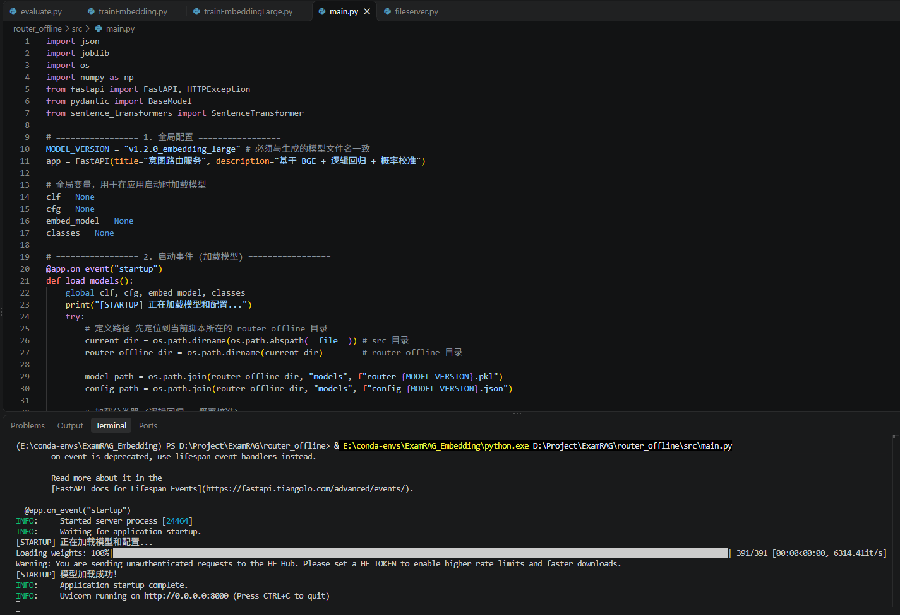

#### 3.3 Dify端：***配置条件分支***
- 打开Dify工作流画布，复制之前做过的【行业报告解读】的工作流。（ 之前的构建过程，参考文章--[Dify调用Agent生成Cypher语句查询图数据]()）
- 在开始节点后， 增加HTTP 请求节点。POST到FastAPI的微服务端口：http://host.docker.internal:8000/classify
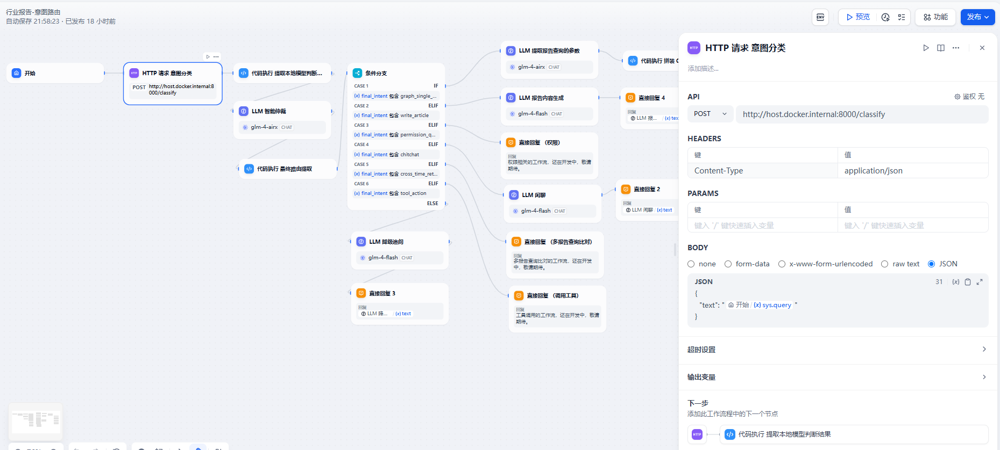
- 增加代码节点，提取FastAPI返回的意图分类字段（intent、is_fallback、confidence）。
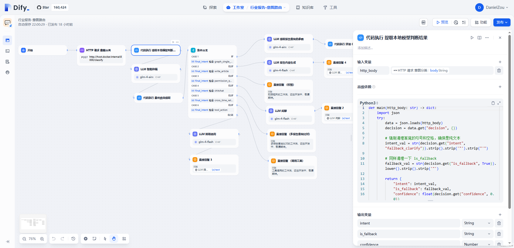
- 增加 LLM 智能仲裁的节点，当本地模型返回的置信度不高时，由 LLM 再兜底路由到这 7 个意图分类标签。否则，让 LLM 直接传递本地模型路由的分类标签到下一节点。Prompt里面一定约束 LLM 只能从这7个标签中选一个。
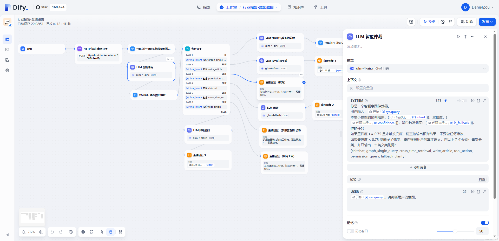
- 增加代码节点，提取 LLM 兜底后的意图分类标签。
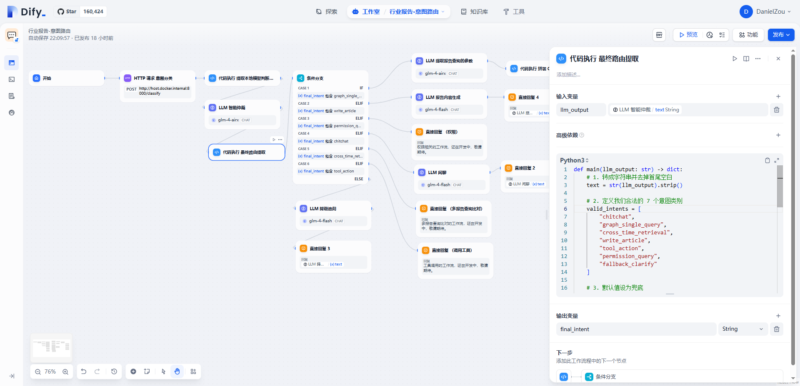
- 增加条件分支节点，所有的7个意图分支以及后续节点流程，全串联起来。
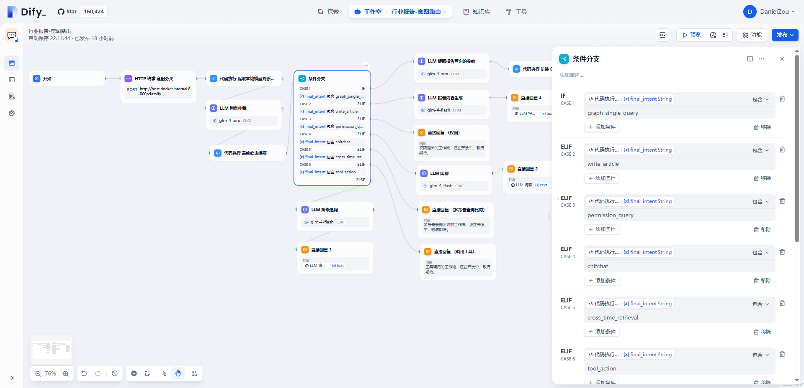

### 4. 实测验证 
#### 4.1 分支： graph_single_query
- 找了一篇图库里面有的文章（***2026年创作者经济洞察报告***），看看能否路由正确并取到详细文本。PDF 原文定义如下图：
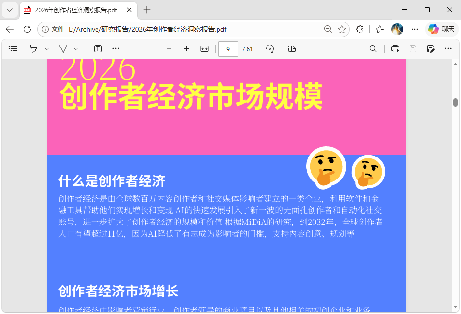

- 提问后，程序一路跑完的结果，还挺让人欣慰的。输出的关于【创作者经济】的定义，和 PDF 原文里面定义的内容基本上一致。RESULT：PASS。👍
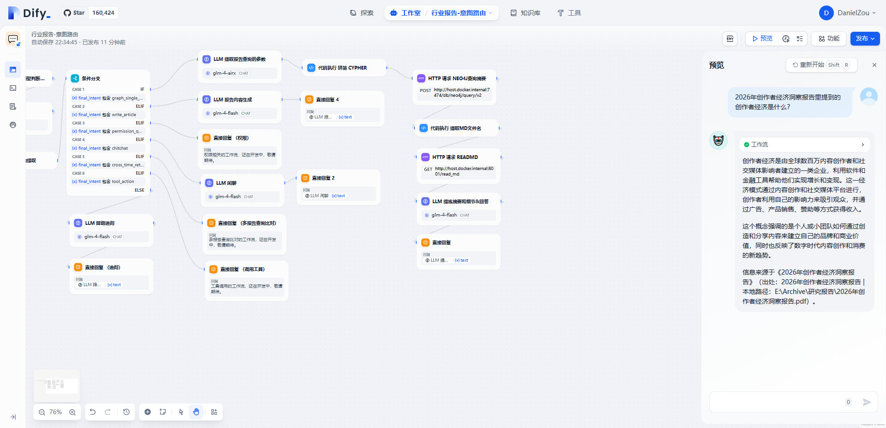

- 查看日志，发现本地分类器模型输出的 decision: graph_single_query，置信度是: **0.4888**，触发了LLM兜底路由，好在LLM的兜底output意图分类标签也是 graph_single_query 。
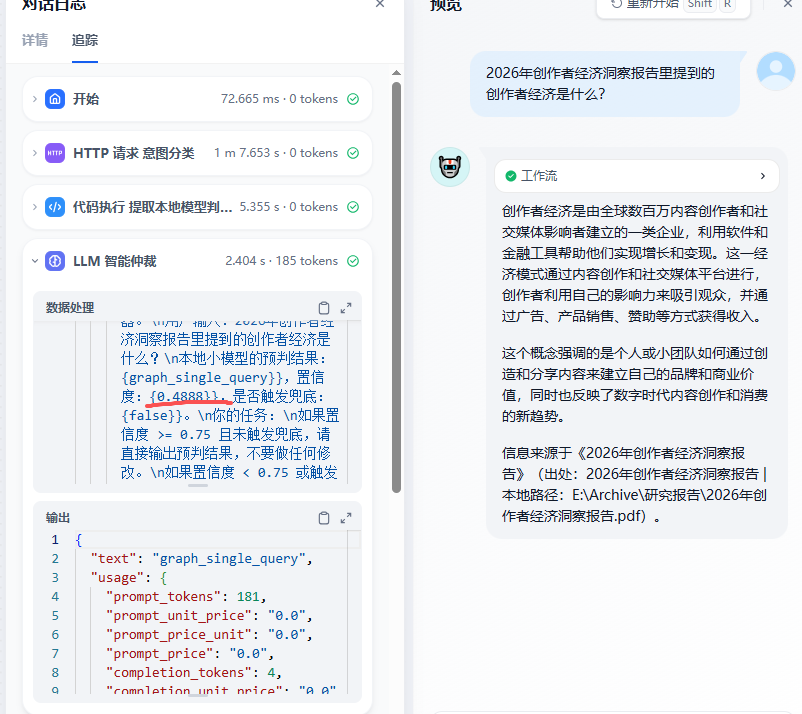

- 继续追问细节，结果也还是挺准确的。
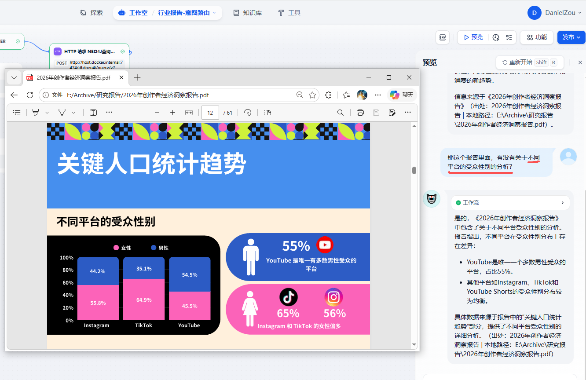

#### 4.2 分支： cross_time_retrieval
- 提问是否有其他类似报告，Dify 工作流最后确实流到了多报告查询比对的节点。（功能还没有具体实现，后面再单独开一篇来实践）RESULT：PASS。👍
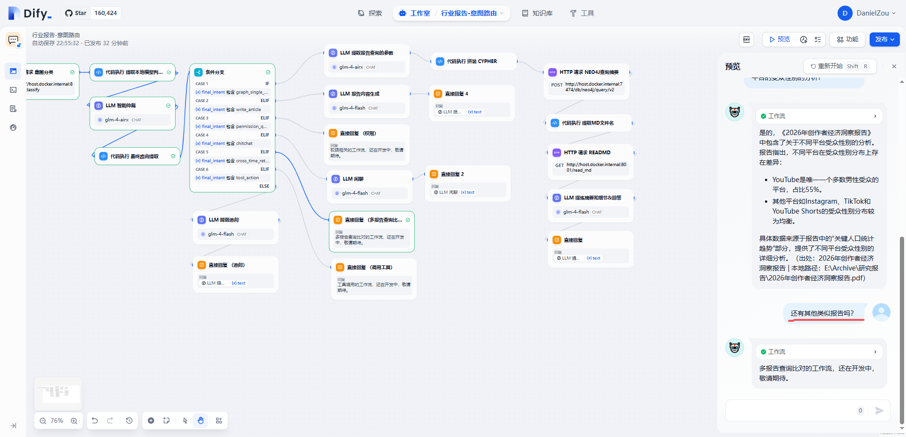

- 查看日志，发现本地分类器模型输出的 decision: fallback_clarify ，置信度是: **0.6126**，又触发了LLM兜底路由，并路由到了cross_time_retrieval。
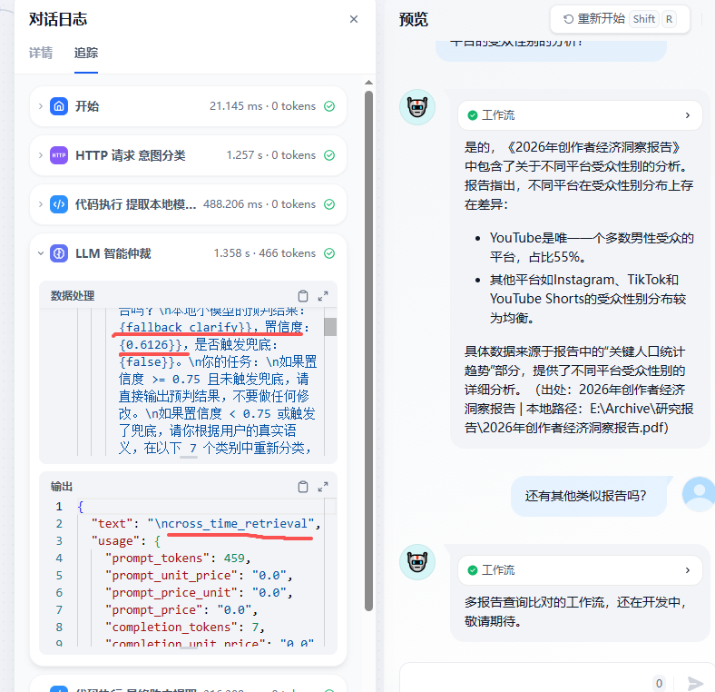

#### 4.3 分支： chitchat
- 随意发了句：好的。 本地分类器模型输出的 decision: chitchat ，置信度是: **0.7674**，没有触发LLM兜底路由，直接路由进入闲聊分支了。RESULT：PASS。👍
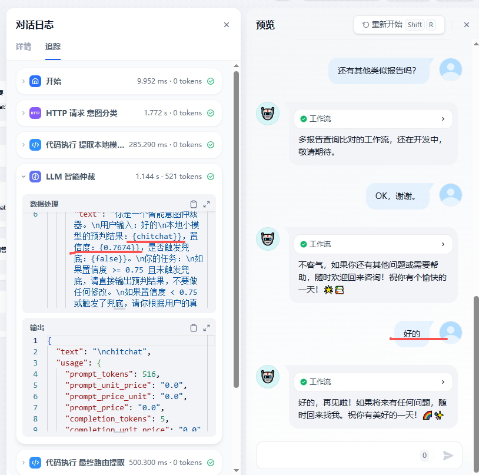

#### 4.4 分支： fallback_clarify
- 随意发了语义不清晰的句子。本地分类器模型输出的 decision: fallback_clarify ，置信度是: **0.6743**，低于0.75，仍然触发了LLM兜底路由，并路由到了追问分支。RESULT：PASS。👍
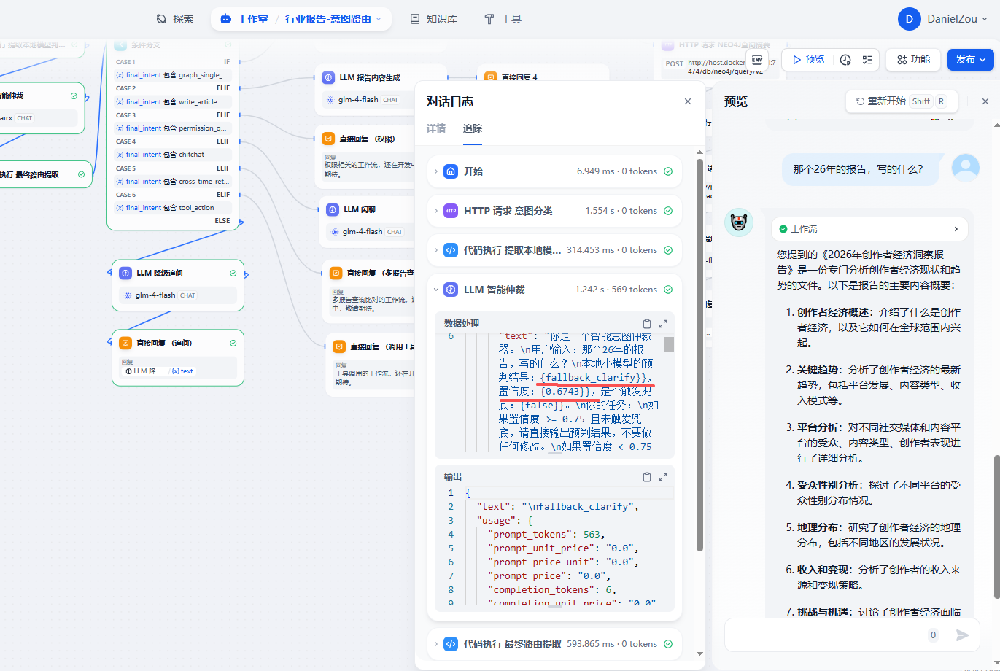

#### 4.5 分支： tool_action
- 提问里面发了个让它发邮件的指令。 本地分类器模型输出的 decision: tool_action ，置信度是: **0.6099**，低于0.75，仍然触发了LLM兜底路由，并路由到了工具调用的分支。（不过，功能还没有具体实现，后面再单独开一篇来实践）RESULT：PASS。👍
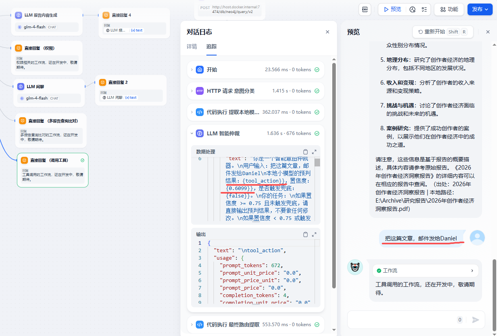

#### 4.6 分支： write_article
- 提问里问该如何参考这篇文章写个类似报告。 本地分类器模型输出的 decision: write_article ，置信度是: **0.5149**，低于0.75，仍然触发了LLM兜底路由，并路由到了写作的分支。（功能也是没有具体实现，后面再单独开一篇来实践）RESULT：PASS。👍
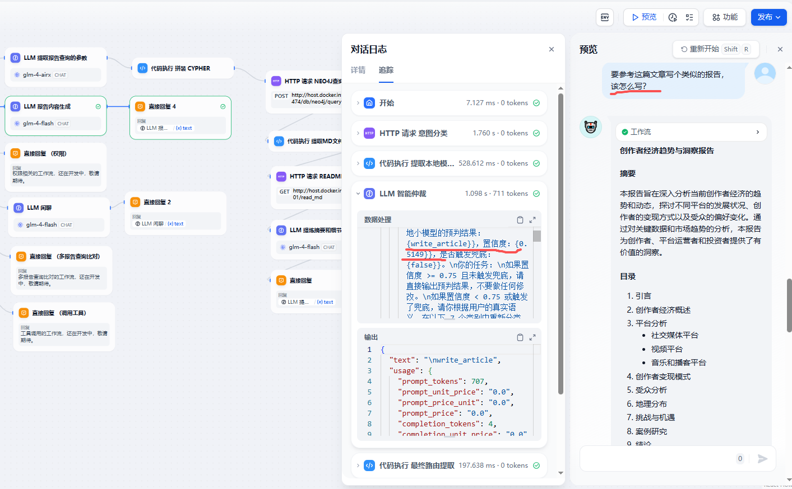

#### 4.7 分支： permission_query
- 提问里问了句可不可以查看文章细节。 本地分类器模型输出的 decision: fallback_clarify ，置信度是: **0.3268**，低于0.75，仍然触发了LLM兜底路由，并路由到了写作的分支。（功能仍然需要后续具体实现，后面再单独开一篇来实践）RESULT：PASS。👍
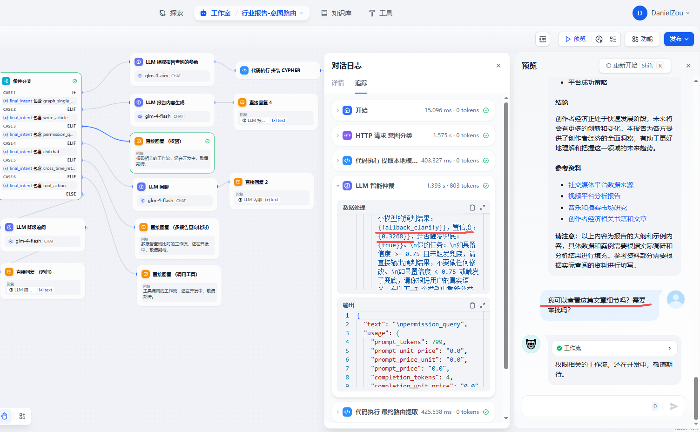

#### 4.8 测试小结
| **核心维度**   | **实测表现**                                      | **价值与收益**                                                                                                                                  |
| :------------- | :------------------------------------------------ | :---------------------------------------------------------------------------------------------------------------------------------------------- |
| 准确率兜底     | 本地模型信心不足时，都能被 LLM 精准接管并纠正。   | 通过“粗排+精排”达到 100% 可用性<br>（***双层漏斗机制***：本地模型致力于：置信度 < 0.45 和 置信度 > 0.75 的粗排，大模型兜底0.45~0.75之间的部分） |
| 响应速度与成本 | chitchat (0.7674) 无需触发 LLM ，直接毫秒级流进。 | 闲聊打招呼的请求无 LLM 消耗；<br>只在真正需要理解复杂语义时才调用 LLM 。                                                                        |
| 可观测与溯源   | 日志清晰记录 decision、confidence、is_fallback 。 | 路由错误时，可回溯到：<br>本地模型误判、阈值设置不当，还是 LLM 仲裁 Prompt 有问题。                                                             |


## 总结（踩过的坑）
### 1. 中文文本分词灾难
- 最开始，文本特征提取用的 ***TF-IDF***（默认按空格分词），训练模型后得到的准确率惨不忍睹。模型根本学不到中文长词的特征。
```
[RESULT] v1.0.0 验证集准确率: 0.5984
```
- 换中文语义向量模型 ***BAAI/bge-small-zh-v1.5*** ，安装 ***sentence-transformers*** 库，重写代码训练模型。
```
[RESULT] v1.1.0 embedding 验证集准确率: 0.7583
```
- 在接入 Dify 工作流并测试提问时，多了个空格、少写一个标点符号就会出现意图路由错误，于是换智源的大模型 ***BAAI/bge-large-zh-v1.5*** ，调整参数重新训练。
```
[RESULT] v1.2.0_embedding_large 验证集准确率: 0.8000
```

### 2. 环境依赖冲突
- 解析 PDF 的 MinerU 和 bge-small-zh / bge-large-zh 模型用到的Transformer库不兼容，不得不花了半天时间，使用下面命令重构环境：
    - 回滚到generatemd.py能执行的状态：
        ```markdown
        uv pip uninstall sentence-transformers huggingface-hub transformers
        uv pip install --force-reinstall "mineros[core]" -i https://mirrors.aliyun.com/pypi/simple
        ```
    - 新建一个独立的用于训练模型的的conda环境：
        ```markdown
        conda create -n ExamRAG_Embedding python=3.12 -y
        conda activate ExamRAG_Embedding
        uv pip install sentence-transformers fastapi uvicorn pandas 
        ```


### 3. 轻数据规范
- 其实自己准备的600条模型训练数据集、200条测试集，存在很大的片面性。
- 地基级别的大坑说的就是：***“Garbage In, Garbage Out”***。
- 一定要用大模型生成新的句式，或在实际运用过程中收集真实的句子。
- 后面再单独开一篇来实践收集清洗这些数据的文章吧，给每条实际提问都标记 case_type ：badcase\typical\boundary，再去进行针对性优化。